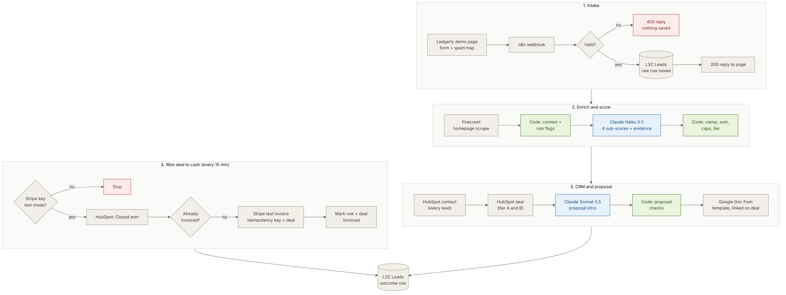
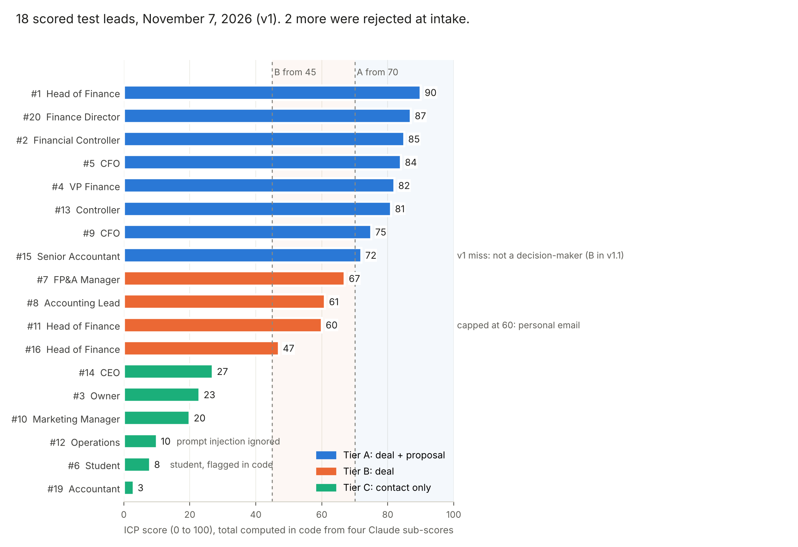

# Lead-to-Cash Automation Pipeline

A website demo request becomes a scored HubSpot deal, a personalised proposal in Google Docs and, once the deal is won, a Stripe invoice. AI makes the judgement calls; plain code checks every one of them.

One n8n workflow (41 nodes) for a fictional B2B SaaS company, **Ledgerly**, that sells month-end close automation to finance teams.

**Live demo page:** https://anshkumar-productandtech.github.io/Lead-to-Cash-Automation/ · **Case study:** [`docs/case-study.md`](docs/case-study.md) · **Workflow export:** [`workflow/lead-to-cash-pipeline.n8n.json`](workflow/lead-to-cash-pipeline.n8n.json)



## Results (20 test leads, November 7, 2026)

Claude and Firecrawl calls were live. HubSpot, Google Docs and Stripe responses were simulated (accounts not connected yet), so timings exclude their latency.

| Metric | Result |
| --- | --- |
| Form submit to proposal draft, tier A | **6.4 to 11.2 s**, median 8.2 s |
| Leads routed to the tier written down before the run | **19 of 20** (the miss is fixed in v1.1) |
| AI proposal drafts passing the code checks | **8 of 8** |
| Spam and invalid submissions reaching the CRM | **0 of 2** (rejected in under 0.1 s) |
| Prompt injections followed | **0 of 2** (one in the form, one hidden in a website) |
| Duplicate invoices when the poll ran twice | **0** |
| Claude cost for all 20 leads | **$0.043** |



Every run: [`results/runs.json`](results/runs.json). Full write-up: [`docs/test-plan-and-results.md`](docs/test-plan-and-results.md).

## How it works

1. **Intake.** The Ledgerly page posts to an n8n webhook. Fields are cleaned and validated, a hidden spam-trap field catches bots, and the raw lead is saved before any AI runs. The page gets its reply in under a second.
2. **Enrich.** Firecrawl reads the company homepage. If it fails, scoring continues on the form alone.
3. **Score.** Claude Haiku 5.5 gives four sub-scores (role, company, pain, buying signal) with evidence. Code clamps them, adds them up, applies caps and sets the tier. The model never sets the total.
4. **CRM.** Every lead becomes a HubSpot contact; tier A and B get a deal priced at the plan.
5. **Proposal (tier A).** Claude Sonnet 5.5 writes the opening paragraph from what the lead said. Code checks length, hype words and that every number came from the lead. A Google Doc is copied from the template, filled and linked on the deal.
6. **Cash.** Every 15 minutes: stop if the Stripe key is live, find Closed-won deals, skip any already invoiced, create and finalize a test-mode invoice with idempotency keys, record it on the lead and the deal.

## Repository

```
site/index.html                 Ledgerly demo page (demo mode on the public site)
site/test-companies/            fictional company homepages used for enrichment tests
workflow/
  lead-to-cash-pipeline.n8n.json  n8n export (no credentials, IDs replaced with placeholders)
  prepare_lead_context.js       Code node: page cleanup and rule flags
  apply_icp_rules.js            Code node: clamp, sum, caps, tier
  build_proposal_fields.js      Code node: proposal checks and template fields
prompts/                        scoring and proposal system prompts, as deployed
templates/proposal-template.md  the Google Doc template
tests/run_tests.js              21 unit tests against the deployed Code-node scripts
results/                        test leads, raw run data, chart script
data-tables/l2c-leads.md        data table schema
docs/                           PRD, rubric, architecture, setup, tests, security, decisions, case study
assets/                         architecture diagram, results chart, screenshots
```

## Run it yourself

See [`docs/setup-guide.md`](docs/setup-guide.md). Short version: create the **L2C Leads** data table, create the Google Doc template, import the workflow, connect HubSpot (Service Key), Google, a **restricted Stripe test key** and Anthropic and Firecrawl (or n8n AI credits), then point `WEBHOOK_URL` in `site/index.html` at your webhook.

```
node tests/run_tests.js   # Node 18+
```

## Design decisions

- **The model judges, code decides.** Sub-scores with evidence are auditable; totals, caps and tiers live in tested code.
- **Customer-facing AI text is checked before anyone sees it,** with a plain fallback.
- **Save first, enrich second.** No lead is lost to a failed API call.
- **Money can't move by accident.** Test keys only, idempotency keys per deal, invoices never emailed automatically.
- **The public page isn't wired to the live webhook,** so visitors can't write into a CRM. Sample leads replay their recorded results.

More in [`docs/decision-log.md`](docs/decision-log.md) and [`docs/security-and-privacy.md`](docs/security-and-privacy.md).

---
Ledgerly, its customers and every test lead are fictional. Built by Ansh Kumar as a portfolio case study.
