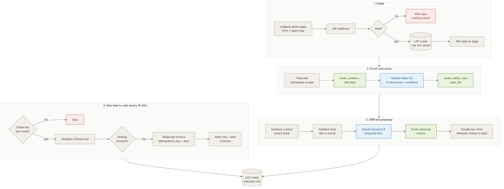

# Architecture

Blue boxes call an AI model. Green boxes are plain code that checks or overrides what the model returned. One n8n workflow, 41 nodes, two triggers.

## Flow 1: new lead (webhook trigger)

| # | Node | Type | What it does |
| --- | --- | --- | --- |
| 1 | Website Lead Form | Webhook (POST `/webhook/ledgerly-demo-request`) | Receives the form; bot user agents ignored |
| 2 | Normalize Lead | Edit Fields | Trims and caps every field, lowercases email and domain (not the URL path), adds `lead_id` |
| 3 | Valid Lead? | If | Email regex, first name, company, empty spam trap |
| 4 | Save Raw Lead | Data Table insert | Stores the lead and the untouched form JSON |
| 5 | Respond Success / Respond Rejected | Respond to Webhook | `200 {ok, lead_id}` or `400 {ok:false, error}` |
| 6 | Has Website? | If | Skip scraping when no website was given |
| 7 | Scrape Company Website | Firecrawl scrape (markdown, main content) | Continues on error |
| 8 | Prepare Lead Context | Code | Cleans the page text (4,000 chars max), sets `enrichment_status` and rule flags |
| 9 | Score Lead with Claude | Anthropic, `claude-haiku-5-5`, 4,000 max tokens, 2 tries | Returns four sub-scores with evidence, plan, pain points, summary, confidence |
| 10 | Apply ICP Rules | Code | Clamp, sum, caps, decision-maker rule, tier, plan, deal text |
| 11 | Upsert HubSpot Contact | HubSpot | Lifecycle stage from tier |
| 12 | Needs Deal? → Create HubSpot Deal | If, HubSpot | Tier A and B; amount = plan price; contact associated |
| 13 | Hot Lead? | If | Tier A only |
| 14 | Write Proposal Intro | Anthropic, `claude-sonnet-5-5` | Intro paragraph and pain points as JSON |
| 15 | Check Proposal Draft | Code | Length, hype words, em dashes, numbers vs lead data; fallback text if any check fails |
| 16 | Copy Proposal Template → Fill Proposal | Google Drive copy, Google Docs replace-all | Ten `[[PLACEHOLDER]]` fields |
| 17 | Link Proposal to Deal | HubSpot deal update | Adds the doc link (and any fallback note) |
| 18 | Record Outcome | Data Table update | Score, tier, IDs, tokens, errors, status |

## Flow 2: won deal to invoice (every 15 minutes)

| # | Node | What it does |
| --- | --- | --- |
| 1 | Check Stripe Mode | `GET /v1/balance`, read only, to see `livemode` |
| 2 | Test Mode Only? → Stop: Live Stripe Key | Stops the run on a live key |
| 3 | Find Won Deals | HubSpot search, `dealstage = closedwon` |
| 4 | Find Lead for Deal | Data table lookup by `hubspot_deal_id`; deals not created by this pipeline drop out |
| 5 | Not Invoiced Yet | Skips rows that already have `stripe_invoice_id` |
| 6 | Prepare Invoice, Has Amount | Amount from the HubSpot deal (falls back to the plan price), in cents |
| 7 | Create Stripe Customer → Create Draft Invoice → Add Invoice Line → Finalize Invoice | Stripe REST, each with `Idempotency-Key: l2c-<step>-<deal id>`; `collection_method=send_invoice`, `days_until_due=30`, `auto_advance=false` |
| 8 | Mark Lead Invoiced | Writes the invoice id and hosted URL; this is what makes the next poll skip the deal |
| 9 | Note Invoice on Deal | Appends the invoice number and link to the deal description |

The Stripe calls use the HTTP Request node because n8n's Stripe node has no invoice operations and can't send idempotency keys.

## Models and why

| Step | Model | Why | Measured |
| --- | --- | --- | --- |
| Scoring | Claude Haiku 5.5 | Structured extraction against a rubric; runs on every lead, so cost matters | 1,282 to 1,696 input tokens, 447 to 1,161 output; $0.0004 to $0.0008 per lead |
| Proposal intro | Claude Sonnet 5.5 | Customer-facing tone; only tier A leads | 497 to 899 input, 186 to 940 output; $0.003 to $0.011 per proposal |

Both ran on n8n's built-in AI credits in testing. Prices: Anthropic list prices, checked Nov 7, 2026.

## Data

One table, [`L2C Leads`](../data-tables/l2c-leads.md). It is the audit log (raw form, AI evidence, tokens, errors) and the dedupe key for invoicing. HubSpot stays the system of record for sales.

## Failure behaviour

| Failure | What happens |
| --- | --- |
| Website down, fake or blocked | `enrichment_status = failed`; scored on the form alone |
| Claude error or unparseable JSON | Tier `review`, contact only, `status = needs_review` |
| HubSpot contact fails | No deal attempted; error text in `error` column |
| Proposal draft fails a check | Fallback sentence used; reason written on the deal |
| Drive or Docs fails | Deal exists without a doc link; error recorded |
| Stripe key is live | Run stops before any search or write |
| Poll runs twice | Second run finds `stripe_invoice_id` and skips; Stripe idempotency keys cover a crash between steps |
