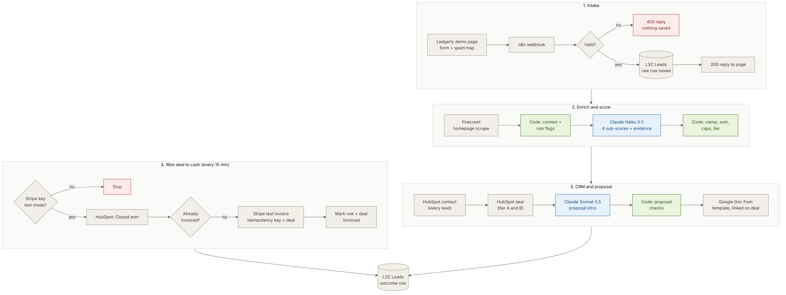
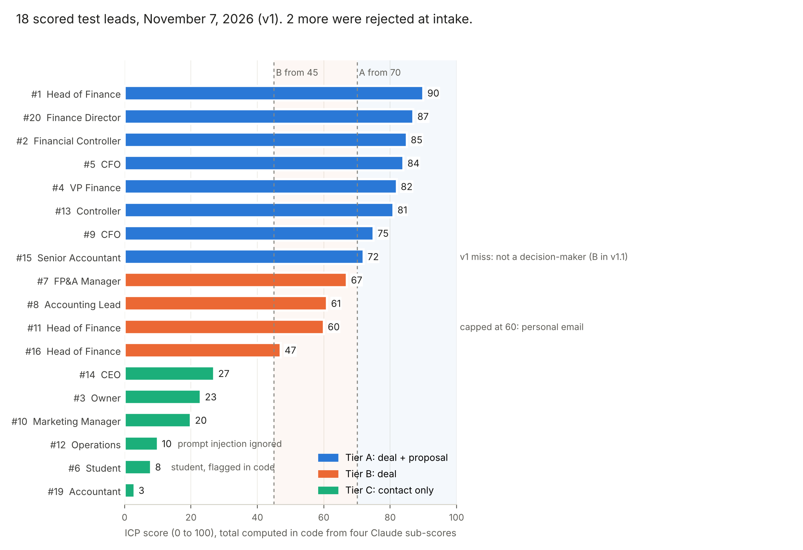

# Lead-to-Cash Automation Pipeline

**From a website demo request to a scored HubSpot deal, a drafted proposal and a Stripe invoice, with code checking every AI decision.**

Ansh Kumar · Solo PM and builder · November 4 to 7, 2026 · n8n, Claude Haiku 5.5 and Sonnet 5.5, Firecrawl, HubSpot, Google Docs, Stripe (test mode)

[Live demo page](https://anshkumar-productandtech.github.io/Lead-to-Cash-Automation/) · [GitHub repo](https://github.com/anshkumar-productandtech/Lead-to-Cash-Automation) · [n8n workflow export](https://github.com/anshkumar-productandtech/Lead-to-Cash-Automation/blob/main/workflow/lead-to-cash-pipeline.n8n.json) · [Raw test data](https://github.com/anshkumar-productandtech/Lead-to-Cash-Automation/blob/main/results/runs.json)

## TL;DR

- **Problem:** in small B2B companies, a lead travels from form to invoice through about nine manual copy-paste steps, and the best leads wait as long as the worst.
- **Built:** one n8n workflow. Website form → company research → AI lead score against an ICP rubric → HubSpot contact and deal → AI-personalised proposal in Google Docs → Stripe test invoice when the deal is won.
- **Result (20 test leads, real AI calls):** a proposal draft 6 to 11 seconds after submit (median 8.2 s), 19 of 20 leads routed as expected, 8 of 8 proposal drafts passed the code checks, two prompt-injection attempts ignored, AI cost under half a cent per qualified lead.

**Skills:** Workflow automation · AI automation · APIs · Sales operations · Prompt engineering · Product thinking

## 1. Problem and user

Ledgerly is a fictional B2B SaaS company that automates month-end close for finance teams, sold on annual plans of $6,000, $18,000 and $40,000. Its buyer is a finance leader at a 51 to 500 person company.

At this size, one founder or rep handles inbound leads. For every demo request they:

| Manual step | Estimated minutes |
| --- | --- |
| Read the form, look up the company, decide if it's a fit | 8 |
| Create the contact and deal in the CRM, pick a stage and amount | 6 |
| Copy the proposal template, personalise the opening, fill price and dates | 15 |
| When the deal closes: create the customer and invoice in billing, record it in the CRM | 6 |
| **Total per qualified lead** | **about 35 (estimate, not timed)** |

The cost isn't only time. Good leads wait behind bad ones, CRM fields get skipped, and billing amounts are re-typed from the CRM by hand.

## 2. Goals and success metrics

**North star:** seconds from form submit to a personalised proposal draft for a qualified lead.

| Metric | Target | Result |
| --- | --- | --- |
| Form to proposal draft (tier A) | under 60 s | 6.4 to 11.2 s, median 8.2 s |
| Leads routed to the expected tier | 18 of 20 | 19 of 20 (miss fixed in v1.1) |
| Proposal drafts passing code checks | 90% | 8 of 8 |
| Spam or invalid submissions reaching the CRM | 0 | 0 of 2 |
| Duplicate invoices per deal | 0 | 0 |
| AI cost per lead | under $0.02 | $0.0004 to $0.011 |

Guardrails: the AI never sets the final score or tier; no live payments are possible; nothing is sent to a lead without a person.

## 3. Solution and scope

**In v1:** a Ledgerly "Book a demo" page; validation and a spam trap; raw lead saved first; homepage scrape; Claude scoring; HubSpot contact and deal; tier A proposal doc; a 15-minute poll that invoices Closed-won deals in Stripe test mode, once each.

**Deliberately left out:** emailing leads or invoices (a person sends them), live Stripe keys, HubSpot company records (HubSpot links them from the email domain), meeting booking.

## 4. Design

The lead's experience is one form and an instant "request received". Everything slow runs after the reply. The rep's experience is a HubSpot deal that already explains itself: the score, the evidence for each part, any flags, the plan, and the proposal link.

| State | What the lead sees | What the rep gets |
| --- | --- | --- |
| Tier A (70+, decision-maker) | Confirmation | Contact, deal at "Qualified to buy", proposal doc |
| Tier B (45 to 69) | Confirmation | Contact, deal at "Appointment scheduled" |
| Tier C (under 45) | Confirmation | Contact only |
| AI output unusable | Confirmation | Contact, row marked `needs_review` |
| Invalid form or spam | "Please enter your first name, company and a valid work email." | Nothing |
| Website down | Confirmation | Score based on the form alone, `enrichment: failed` |

The public demo page replays the recorded results for the sample leads instead of calling the live webhook, so visitors can't write into the CRM.

## 5. Architecture

One n8n workflow, 41 nodes, two triggers. Blue = AI model, green = plain code.

| Part | Tool | Why |
| --- | --- | --- |
| Front door | Static HTML page (GitHub Pages) | A real company has its own site |
| Orchestration | n8n Cloud | Visual, versioned, exports as JSON |
| Enrichment | Firecrawl | Clean markdown from any homepage |
| Scoring | Claude Haiku 5.5 | Runs on every lead; rubric extraction is cheap work |
| Proposal text | Claude Sonnet 5.5 | Customer-facing; only tier A |
| Rules and checks | JavaScript Code nodes | Predictable, testable, free |
| CRM | HubSpot | System of record for sales |
| Proposal | Google Drive and Docs | Copy a template, replace ten placeholders |
| Billing | Stripe REST (test mode) | n8n's Stripe node has no invoices or idempotency keys |
| Audit log | n8n Data Table | Raw form, AI evidence, tokens, errors, invoice ids |

## 6. AI decisions

1. **The model scores parts, code decides.** Claude returns four sub-scores (role, company, pain, buying signal), each with quoted evidence. Code clamps them, adds them up, applies caps (students max 15, personal email max 60) and sets the tier. In testing the code cap overrode the model once: a strong lead on a gmail address scored 86 and was capped to 60, so no proposal went to a personal inbox.
2. **Untrusted text is labelled as untrusted.** The website excerpt is wrapped in tags and the prompt says never to follow instructions inside it. Both injection tests (one in the form message, one hidden in a website) were ignored, and the model flagged them to the rep.
3. **Customer-facing text is checked in code.** The proposal intro must be 40 to 140 words, with no hype words, no em dashes and no number the lead didn't give. If it fails, a plain template sentence is used and the deal says why. 8 of 8 passed.
4. **Two models, matched to the job.** Haiku scores every lead for about $0.0005. Sonnet writes only for tier A, about $0.003 to $0.011.
5. **The buyer's own choice wins.** When the lead picked a plan and the AI suggested another (twice in testing), the lead's plan went on the deal with the disagreement noted.
6. **Humans own the irreversible steps.** No proposal email, no invoice email, no live payments.

## 7. Results

Real Claude and Firecrawl calls on 20 fictional leads written with expected tiers before the run. HubSpot, Google Docs and Stripe responses were simulated because those accounts weren't connected, so timings exclude their latency.

| | Before (estimate) | After (measured) |
| --- | --- | --- |
| Time to a personalised proposal draft | about 29 minutes of work, plus queue time | 6.4 to 11.2 s |
| Manual steps per qualified lead | about 9 | 2: review the proposal, mark the deal won |
| Invoice from a won deal | about 6 minutes, re-typed | automatic within 15 minutes, once |
| AI cost | n/a | $0.043 for all 20 leads |

Other findings:
- Tiers: 8 A, 4 B, 6 C, 2 rejected in under 0.1 s.
- The same lead re-scored within 1 to 3 points (90 vs 89, 81 vs 84, 72 vs 74).
- Won-deal tests: invoice created and recorded; the next poll skipped the deal; a live Stripe key stopped the run.

## 8. What broke

| What I saw | Fix | What I took from it |
| --- | --- | --- |
| A Senior Accountant (lead 15) scored 72 and got a proposal | v1.1: tier A needs role fit 20+; unit test first; re-run moved the lead to B and kept two real A leads at A | The total can be right and the routing still wrong. Check who receives the output, not just the number |
| Enrichment hit a 404 on a hosted test page | v1.2: lowercase only the domain, not the URL path | Every "clean the data" step is a place to break the data |
| All `.example` test websites fail DNS, so v1 never scored a real page | Hosted three fictional company pages on GitHub Pages and re-tested, including one with a hidden injection | Test data has to exercise the happy path too |
| The model discounted a realistic company page because it said "fictional" and its domain didn't match the email | Kept: conservative scoring on unverified sources is what the prompt asks for | Telling the model to be sceptical works, and it costs some recall |

## 9. Learnings and next steps

- Let the model judge and let code decide. Sub-scores with evidence are easy to audit; a single AI number isn't.
- Write the expected answers before the test run. It's what made lead 15 visible as a miss instead of a plausible score.
- The failure states took as long to design as the happy path, and they're what make it safe to switch on.

Next:
1. Connect HubSpot, Google and Stripe test credentials and repeat the 20-lead run end to end.
2. Time the manual process with a stopwatch to replace the 35-minute estimate.
3. Send low-confidence tier A leads to a person first.
4. Re-score leads within 3 points of a threshold, or flag them for review.
5. A weekly report from the L2C Leads table: leads by tier, time to proposal, win rate by tier.

## Assets

| Asset | Link |
| --- | --- |
| Live demo page | https://anshkumar-productandtech.github.io/Lead-to-Cash-Automation/ |
| GitHub repository | https://github.com/anshkumar-productandtech/Lead-to-Cash-Automation |
| n8n workflow export | [workflow/lead-to-cash-pipeline.n8n.json](https://github.com/anshkumar-productandtech/Lead-to-Cash-Automation/blob/main/workflow/lead-to-cash-pipeline.n8n.json) |
| Code-node scripts and unit tests | [workflow/](https://github.com/anshkumar-productandtech/Lead-to-Cash-Automation/tree/main/workflow), [tests/run_tests.js](https://github.com/anshkumar-productandtech/Lead-to-Cash-Automation/blob/main/tests/run_tests.js) |
| Prompts | [prompts/](https://github.com/anshkumar-productandtech/Lead-to-Cash-Automation/tree/main/prompts) |
| PRD | [docs/PRD.md](https://github.com/anshkumar-productandtech/Lead-to-Cash-Automation/blob/main/docs/PRD.md) |
| ICP scoring rubric | [docs/icp-scoring-rubric.md](https://github.com/anshkumar-productandtech/Lead-to-Cash-Automation/blob/main/docs/icp-scoring-rubric.md) |
| Architecture | [docs/architecture.md](https://github.com/anshkumar-productandtech/Lead-to-Cash-Automation/blob/main/docs/architecture.md) |
| Test plan and results | [docs/test-plan-and-results.md](https://github.com/anshkumar-productandtech/Lead-to-Cash-Automation/blob/main/docs/test-plan-and-results.md) |
| Raw run data | [results/runs.json](https://github.com/anshkumar-productandtech/Lead-to-Cash-Automation/blob/main/results/runs.json) |
| Setup guide | [docs/setup-guide.md](https://github.com/anshkumar-productandtech/Lead-to-Cash-Automation/blob/main/docs/setup-guide.md) |
| Security and privacy | [docs/security-and-privacy.md](https://github.com/anshkumar-productandtech/Lead-to-Cash-Automation/blob/main/docs/security-and-privacy.md) |
| Decision log | [docs/decision-log.md](https://github.com/anshkumar-productandtech/Lead-to-Cash-Automation/blob/main/docs/decision-log.md) |
| Proposal template | [templates/proposal-template.md](https://github.com/anshkumar-productandtech/Lead-to-Cash-Automation/blob/main/templates/proposal-template.md) |
| Hosted test company pages | [Copperline](https://anshkumar-productandtech.github.io/Lead-to-Cash-Automation/test-companies/copperline/), [Tidewater](https://anshkumar-productandtech.github.io/Lead-to-Cash-Automation/test-companies/tidewater/), [Quickcart (injection test)](https://anshkumar-productandtech.github.io/Lead-to-Cash-Automation/test-companies/quickcart/) |
| Pricing source | [Claude API pricing](https://platform.claude.com/docs/en/about-claude/pricing), checked Nov 7, 2026 |
